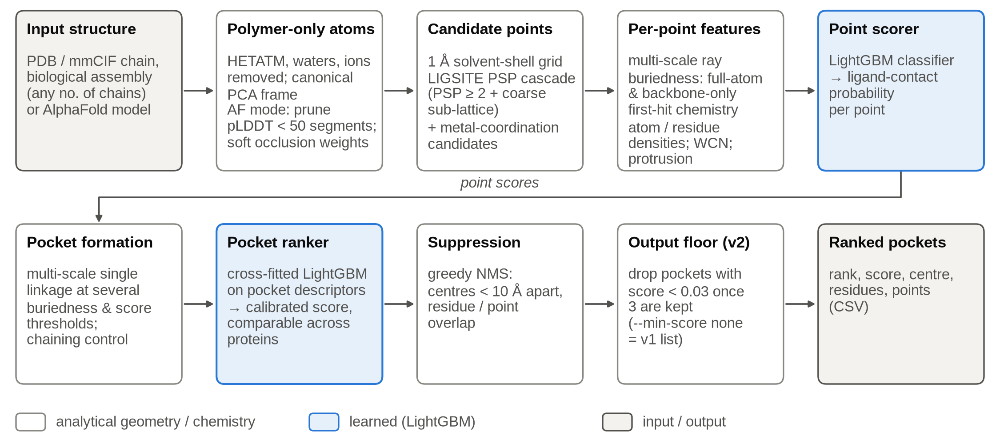
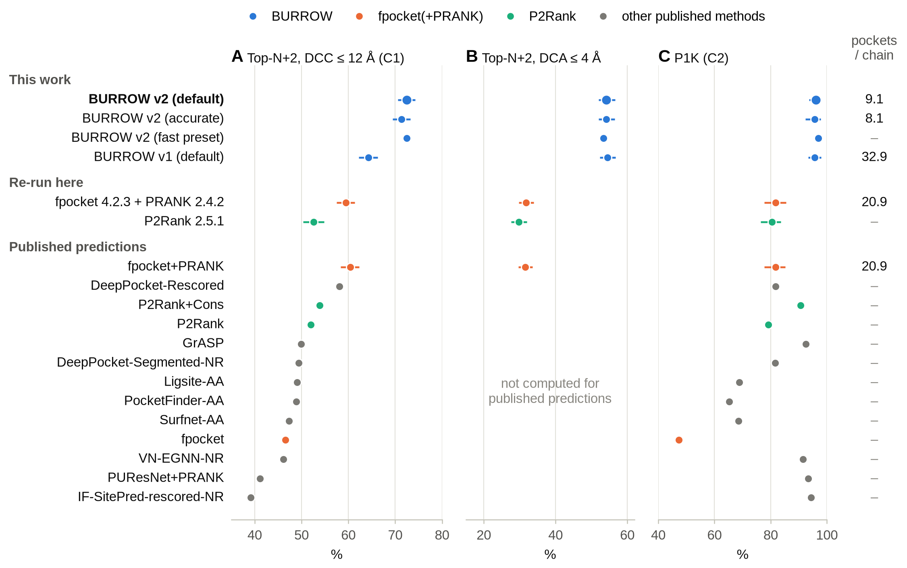
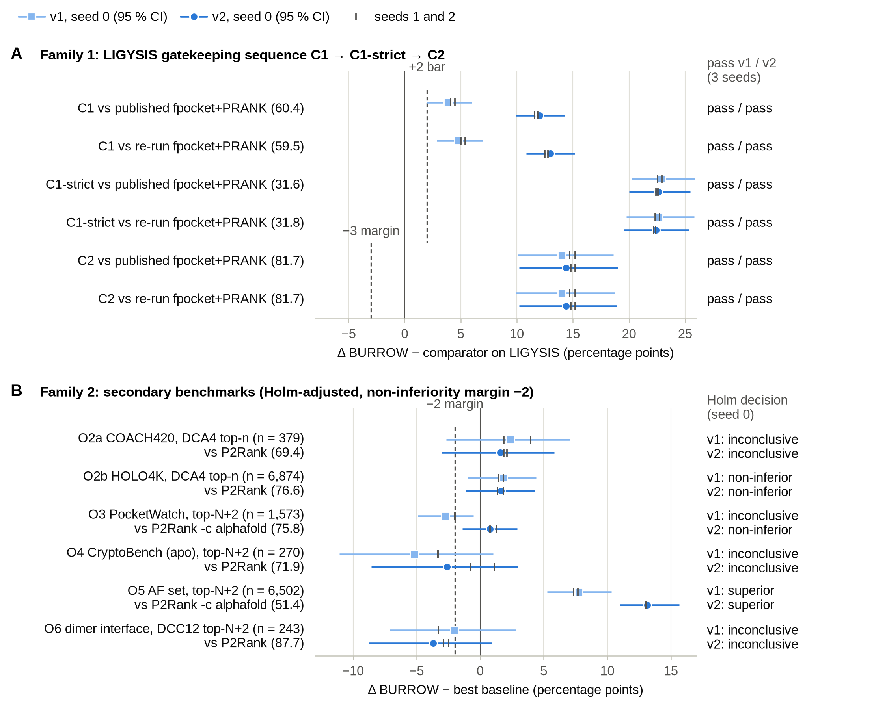
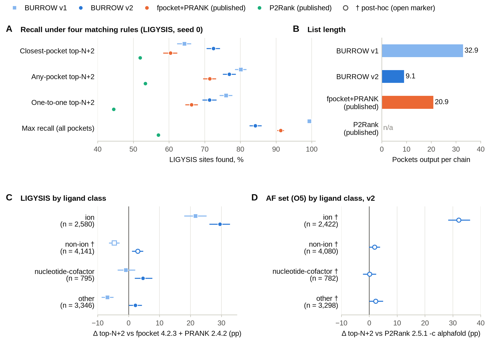
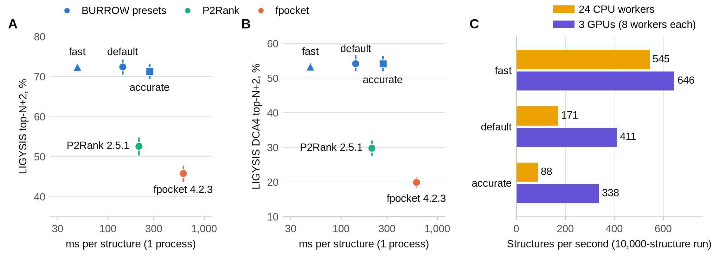
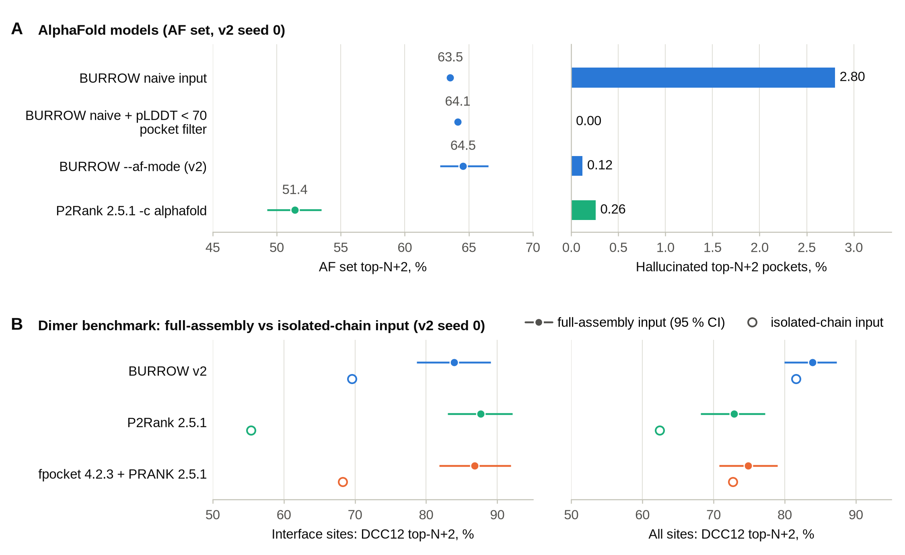

# BURROW: a fast protein pocket finder and ranker, designed, built and benchmarked end to end by AI agents

[Author list to be completed by the submitting authors]

**AI-contribution statement.** All content of this article (study design, code, data curation, analyses, figures and text) was produced by AI agents: a principal-investigator agent and the sub-agents that it launched (Claude Code; Claude Opus 5.5 and Claude Sonnet 5.5; Anthropic). The human authors set up the computing environment, wrote the initial prompt, granted one time extension, asked three follow-up questions, requested this manuscript, and take responsibility for its submission. See the box below, Methods and S2 Text.

> **How this work was produced.** This study is an experiment that tests whether AI agents can run a bioinformatics project from start to finish. AI agents did all of the work: the literature review, the design and its reviews, the pre-registration, the data curation, the code, the experiments, the statistical analyses, the figures and this text. The agents were a principal-investigator (PI) agent and about 25 sub-agents that it launched (Claude Code with Claude Opus 5.5 and Claude Sonnet 5.5). They started from a single prompt, which is reproduced verbatim in S2 Text and in the repository file PROMPT.md. Human input was minimal. A human set up the compute environment and its data mounts and wrote the prompt. The same human later granted a 3–4 h time extension, asked three follow-up questions (about multimers, GPU use and remaining ideas), supplied a writing guide, and asked for this manuscript. The human did not write code, choose methods, select results or edit text. The Methods section ("Agent-based project execution") describes the agent setup.

## Abstract

Finding and ranking ligand-binding pockets in protein structures is a basic step in structure-based biology, and fast tools such as P2Rank remain hard to beat. We report BURROW, a pocket finder that uses no neural network, and how it was made: AI agents planned, built and benchmarked it from a single prompt with minimal human input. BURROW places candidate volume elements on a 1 Å grid and describes each point by ray-cast buriedness and by the chemistry of the first atom that each ray hits. Two gradient-boosted tree models score the points and rank the pockets, so that scores are comparable across proteins. Claims and statistical tests were fixed before any test-set run, an independent agent audited the training data for leakage, and another recomputed the headline numbers. On LIGYSIS (2,775 chains, 6,721 sites), BURROW's top-N+2 recall was 72.5%, against 60.4% for the best published method (fpocket+PRANK) and 52.6% for P2Rank. Its success rate within 4 Å of ligand atoms was 54.2% against 31.6%. Most of the margin came from ion sites (+29.5 points); on non-ion sites the gain was +3.0 to +3.5 points. Part of the gain came from shorter output lists, which score better under the closest-pocket rule of the benchmark. BURROW was non-inferior to P2Rank on HOLO4K and on a temporal benchmark of predicted structures, and inconclusive on COACH420, apo/cryptic sites and dimer interfaces. An AlphaFold mode removed hallucinated pockets (from 2.80% to 0.12% of top-ranked pockets) but did not beat a simple filter at pLDDT 70. Per process, BURROW took 142 ms per structure against 209 ms for P2Rank; an optional fast preset took 48 ms. We describe the agent setup, its decisions and the errors it caught, and we list the goals of the prompt that were not met.

## Author summary

Proteins bind small molecules in pockets on their surface, and finding these pockets is a first step in drug discovery and in understanding protein function. Many computer programs predict pockets, but fair comparisons between them are hard. Test proteins often resemble training proteins, benchmarks differ in what counts as a binding site, and the length of a program's output list can change its score. We asked whether AI agents, working from a single written instruction, could build a better pocket finder and test it honestly. A team of AI agents read the literature and wrote and reviewed a design. They also fixed their statistical tests in advance, built training data without overlap with the test proteins, and wrote and benchmarked the software. The resulting method, BURROW, finds more known binding sites than existing tools on a large benchmark and runs in about a tenth of a second per protein. The agents also showed where the advantage comes from: mostly metal-ion sites, and shorter output lists. They found no advantage on hidden (cryptic) pockets or on pockets between two protein chains. The study shows what agent-run research can deliver and where human oversight is still needed.

## Introduction

This article reports both a method and an experiment. The experiment asked whether AI agents can run a computational biology project end to end, from the literature review to a benchmarked tool and a written report. All design, code, analyses and text in this study were produced by AI agents: one PI agent and the sub-agents that it launched. They worked from one prompt (S2 Text), with minimal human input (see the box above and Methods). We report the agents' method and results as a scientific contribution, and we also report how the agents worked, because the process affects how far the results can be trusted.

The scientific task was to build a fast pocket finder that beats existing methods such as P2Rank, generalises across protein families and to apo and AlphaFold structures, handles homo- and heterodimers, and runs on both CPU and GPU (S2 Text). Ligand-binding pocket prediction has a long history. Geometric methods find concave regions from atom coordinates alone. Examples are LIGSITE, which counts protein–solvent–protein events along grid lines [1], PocketPicker, which casts rays to measure buriedness [2], and fpocket, which clusters Voronoi alpha spheres [3]. Knowledge-based methods learn which surface regions bind ligands. PRANK rescores fpocket pockets with a random forest on point features [4], and P2Rank scores points on the solvent-accessible surface, clusters the positive points and ranks the clusters [5]. Deep-learning methods such as DeepPocket, PUResNet, GrASP, VN-EGNN and IF-SitePred use 3D convolutions, graph networks or embeddings from protein language models [6–10].

Fair comparison of these methods is difficult. Utgés and Barton built LIGYSIS, a benchmark of 2,775 human protein chains whose binding sites are pooled across many PDB entries [11]. They re-ran 13 methods under one protocol and found that fpocket rescored by PRANK had the highest top-N+2 recall (60.4%), and that no deep-learning method beat it. Their analysis also showed that fpocket's candidate list contains about 91% of the sites, whereas P2Rank's contains only 57% [11]. We read this as evidence that the room for improvement lies in two places: a candidate set with high recall, and a ranking of those candidates whose scores are comparable across proteins. Other benchmarks address other questions. COACH420 and HOLO4K are the legacy P2Rank test sets [5, 12, 13]. CryptoBench tests cryptic sites on apo structures [14], and PocketWatch uses a temporal split on predicted structures [15]. Leakage between training and test proteins is a recurring problem in this field [14–16].

AlphaFold models add new failure modes [17, 18]. Low-confidence disordered regions can pack against the folded core and create pockets that do not exist. The authors of proteome-wide pocket atlases therefore remove pockets whose mean pLDDT is below 70 [19, 20], and AF2BIND removes terminal and internal low-confidence segments [21]. We found no public benchmark that tests pocket prediction on homo- and heterodimers.

Here we describe BURROW (buriedness-driven ultra-fast ranking of pockets, with confidence awareness). BURROW uses volume-element candidate points, buriedness from ray casting on full-atom and backbone-only grids, and the chemistry of the first atom that each ray hits. It scores points and ranks pockets with gradient-boosted trees, and it has an AlphaFold mode that uses pLDDT. We pre-registered the claims and tests, reproduced the published LIGYSIS numbers before making any comparison, and had independent agents audit leakage and recompute the headline results. We report where BURROW is better, where it is not, and where its apparent gains come from properties of the benchmark rather than of the method.

## Results

### BURROW: high-recall candidates and a calibrated learned ranking

Fig 1 shows the pipeline. BURROW removes everything except protein atoms from the input and builds a 1 Å grid of points in the solvent shell around the protein. Each grid point stands for a small volume of space (a volume element), not a point on the protein surface. A cheap test based on LIGSITE [1] selects the buried points, which are kept at full resolution. Of the remaining points, only a coarser 3 Å sub-lattice is kept, so that shallow sites stay in the pool. Extra candidate points are placed where two or more side-chain atoms could coordinate a metal ion. These sites are often missed by surface-point methods.

> **Fig 1. The BURROW pipeline.** Top row: analytical geometry. Only protein atoms are kept (ligands, waters and ions are removed). In `--af-mode`, low-confidence segments (pLDDT < 50) are removed and atoms get soft occlusion weights, w = clip((pLDDT − 40)/40, 0, 1). Candidate volume elements come from a 1 Å solvent-shell grid that is filtered by a LIGSITE protein–solvent–protein (PSP) test, plus metal-coordination candidates. Each point is described by ray-cast buriedness at several ray lengths (through a full-atom grid and a backbone-only grid), first-hit chemistry, densities of atom and residue classes, weighted contact number (WCN) and protrusion. A LightGBM classifier scores the points. Bottom row: candidate pockets are formed by single linkage at several thresholds of buriedness and point score, with control of chaining. A LightGBM ranker that was trained on cross-fitted point scores ranks them, so that scores are comparable across proteins. A pocket is suppressed if its centre lies within 10 Å of a better-ranked pocket or if it overlaps one. The v2 output floor then drops pockets that score below 0.03 once three have been kept. Blue boxes are learned steps. Parameters are those of the final version (v2, default preset).

> 

Each point is described by 84 features. The main ones come from rays cast in fixed directions through two grids: one built from all heavy atoms and one built from backbone and Cβ atoms only. The fraction of blocked rays at several lengths measures buriedness on several scales. The backbone-only version is less sensitive to side-chain positions. For each ray, BURROW also records the chemical class of the first atom that the ray hits (apolar carbon, polar N or O, charged, or aromatic). We call this enclosure by chemistry: it describes what a ligand at that point would touch, and it is a cheap approximation of desolvation. Other features are local atom and residue counts, a contact-number measure of flexibility, protrusion [5] and metal-coordination geometry.

A LightGBM classifier [22] scores the points. BURROW then forms candidate pockets on several scales, both from buried points and from high-scoring points. A second LightGBM model ranks the pockets. It is trained on cross-fitted point scores, so that the point scores in training follow the same distribution as at prediction time. Its training target is graded and decreases with the distance to the nearest true site. Together, this makes its scores comparable across proteins. Suppression removes pockets whose centres are within 10 Å of a higher-ranked pocket. In the final version (v2), pockets with a ranker score below 0.03 are dropped once three have been kept (the output floor).

Two rankers share the same features. The `all` ranker was trained on ion and non-ion sites. The `small` ranker was trained on non-ion ligands only, which matches the ligand definitions of COACH420, HOLO4K, CryptoBench and PocketWatch. The mapping from benchmark to ranker was fixed before any results existed. Training data came from BioLiP2 [23], with binding sites built in the same way as LIGYSIS sites and with every chain removed that is similar to any test chain (Methods). Table 1 lists the published ideas that BURROW builds on.

**Table 1. Origins of BURROW's design choices.** Ideas taken from published work, and what BURROW changed. "Agents" marks choices that came from the agents' design reviews rather than from a single published source.

| Design element | Source | What BURROW does |
|---|---|---|
| Score points, cluster them, rank the clusters | P2Rank and PRANK [4, 5] | Same three-stage architecture. Points are volume elements on a grid rather than surface points. Gradient-boosted trees replace random forests. A separate pocket ranker is trained on cross-fitted point scores. |
| Candidate recall as the target | LIGYSIS analysis: fpocket's list contains about 91% of sites, P2Rank's 57% [11] | Own grid candidates reach 99.3% maximum recall on LIGYSIS before the output floor. |
| Protein–solvent–protein buriedness | LIGSITE [1, 24] | Used as a cheap first filter that decides which points are kept at full resolution. |
| Buriedness from ray casting, on several scales | PocketPicker [2]; multi-scale buriedness in Ghecom [25] | Fibonacci rays at 6–24 Å through a full-atom grid and a backbone+Cβ grid (the latter tolerates side-chain changes). |
| Protrusion | P2Rank's most important feature [5] | Kept as one feature among many. |
| Enclosure and polarity as druggability descriptors | SiteMap [26]; fpocket druggability score [27] | "Enclosure by chemistry": the chemical class of the first atom that each ray hits. |
| Site definition, redundancy rule, closest-pocket protocol, top-N+2 metric | LIGYSIS [11] | Training sites built the same way (fingerprint clustering, relative intersection, cut 0.5); metric and protocol ported and verified against the authors' code. |
| Relevant-ligand labels | BioLiP2 [23] | Training labels, including metal ions. |
| Removal of low-confidence segments | AF2BIND (termini and internal runs of ≥ 7 residues with pLDDT < 50) [21] | Used unchanged as a fixed prior in `--af-mode`. |
| Pocket filter at mean pLDDT 70 | HOTPocket; Zillmer and Walther [19, 20] | Used as the control baseline that AlphaFold mode had to beat (it did not). |
| Leakage-aware and temporal evaluation | CryptoBench, PocketWatch, PLINDER [14–16] | Test union frozen before training; sequence filter with domain-level coverage; fold-disjoint ablation; independent audit. |
| Metal-site candidates; ions in the headline model | Agents (design review) | Extra candidate points at metal-coordinating side chains; separate `all` and `small` rankers. |
| Pre-registration, Holm correction, cluster bootstrap | Agents (statistics review) [28] | Frozen claims, endpoints, margins and seeds before any test-set run. |

The term "analytical" applies to BURROW's candidates and features, not to its accuracy. When the geometric candidates are ranked without learning, they reach 53.3% top-N+2 recall on our development (dev) set, against 54.1% for P2Rank. The gains reported below come from the learned point scorer and ranker.

### Benchmark design

Table 2 lists the test benchmarks. We pre-registered one primary claim and two follow-up claims on LIGYSIS (family 1, tested in a fixed sequence), and six secondary endpoints with a non-inferiority margin of −2 points and Holm correction (family 2) [28]. All claims were frozen in a pre-registration document before any test-set run. Three amendments were made later, each before the relevant predictions existed (Methods). Before trusting any comparison, the agents checked that our evaluation code reproduced all 33 published LIGYSIS method variants to within 0.5 points, and that our re-runs of P2Rank and fpocket+PRANK matched the published values to within 2 points. Confidence intervals (CIs) are 95% paired cluster-bootstrap intervals over 30% sequence-identity clusters.

**Table 2. Test benchmarks.** All benchmarks were frozen before any BURROW test prediction. Endpoint codes refer to the pre-registered claims (C, family 1; O, family 2). Sites and units are scored sites and cluster-bootstrap units.

| Benchmark | Endpoint | Size | Input |
|---|---|---|---|
| LIGYSIS [11] (C1, C1-strict, C2) | Top-N+2 recall at DCC ≤ 12 Å (closest pocket); DCA ≤ 4 Å; P1K | 2,775 chains, 6,721 sites (6,387 with ligand atoms) | Authors' ligand-free representative chains |
| LIGYSIS without ions (descriptive) | As above | 2,003 chains, 4,141 sites | As above |
| COACH420, HOLO4K (mlig) [5] (O2a, O2b) | DCA ≤ 4 Å, top-n, P2Rank rules | 379 and 6,874 ligands | P2Rank dataset files |
| PocketWatch test [15] (O3) | Top-N+2 at DCC ≤ 12 Å, authors' mask | 1,566 structures, 1,573 sites | Authors' predicted structures, `--af-mode` |
| CryptoBench test [14] (O4) | Top-N+2 at DCC ≤ 12 Å to the site centre on the apo structure | 222 apo structures, 270 sites | Apo structures |
| AlphaFold set, built here (O5) | Top-N+2 at DCC ≤ 12 Å | 2,526 AFDB v6 human models, 6,502 sites | Full-length models, `--af-mode` |
| Dimer set, built here (O6) | Interface top-N+2 at DCC ≤ 12 Å | 400 assemblies, 807 unique sites (243 at interfaces) | PDB assembly 1 |

Two versions of BURROW were scored on the test sets. Version 1 (v1) output the full suppressed list of up to 50 pockets. Version 2 (v2) added the output floor. v2 was chosen using development data before any v1 test score was computed, but 70 minutes after the v1 test prediction files had been written. We report both versions. The pre-registered claims hold for v1 alone.

### LIGYSIS: pre-registered claims pass for both versions

Family 1 passed in full for both versions, all three training seeds and both comparators (Fig 2, Fig 3A, Table 3). For v2, top-N+2 recall at a centre-to-centre distance (DCC) of at most 12 Å was 72.5%, 72.0% and 72.3% for the three seeds, against 60.4% for the published fpocket+PRANK predictions. The smallest difference was +11.6 points, and the lowest CI bound was 9.4. v1 also passed, with 64.3–64.9% and a smallest difference of +3.9 [2.0, 6.0]. P2Rank 2.5.1 reached 52.6%.

> **Fig 2. Pocket prediction on the LIGYSIS test set (2,775 chains, 6,721 binding sites).** (A) Top-N+2 success: a site counts as found when the pocket closest to its centre is within 12 Å (DCC) and has a rank of N+2 or better, where N is the number of sites on the chain (pre-registered endpoint C1). (B) The same with a stricter criterion for a hit: distance to any ligand atom (DCA) ≤ 4 Å (6,387 sites with ligand atoms; C1-strict). (C) Pooled precision P1K (endpoint C2): the share of true positives among the 1,000 highest-scoring pockets pooled over all chains. Right column: mean number of pockets that each method outputs per chain. Because the closest-pocket rule gives less credit to long output lists, top-N+2 must be read together with list length (see Fig 4). Points: seed 0 for BURROW. Bars: 95% paired cluster-bootstrap CIs (30% sequence clusters, 1,687 units, 1,000 resamples), shown where a CI was computed. "Re-run here": P2Rank 2.5.1 and fpocket 4.2.3 + PRANK 2.4.2, run on identical inputs. "Published predictions": the LIGYSIS authors' per-chain predictions, scored with our evaluation code, which reproduces their published numbers to within 0.4 points for all 33 method variants. For these, no CIs or pocket counts were computed, and chains without predictions count as misses. The fast preset was not pre-registered (descriptive).

> 

In the stricter test (C1-strict), a site counts as found only if the pocket closest to the ligand atoms lies within 4 Å of them (DCA ≤ 4 Å) and has a rank of N+2 or better. On this test, BURROW v2 reached 54.0–54.2% against 31.6% for fpocket+PRANK and 29.8% for P2Rank. Pooled precision of the top 1,000 pockets (P1K) was 96.1–96.9% against 81.7%. This precision was pre-registered only as non-inferiority, but it was superior. The best published P1K on LIGYSIS, 94.3% for a rescored IF-SitePred variant, is 1.8 points lower than BURROW's. We did not test that difference. An independent agent recomputed all headline numbers with no project code, and used the LIGYSIS authors' own code for C1. All values matched to within 0.2 points.

**Table 3. Pre-registered test results (seed 0).** Values are percentages; Δ is BURROW minus the comparator in percentage points, with 95% paired cluster-bootstrap CIs. Family 1 comparator: published fpocket+PRANK predictions. Family 2 comparator: the better of P2Rank 2.5.1 and fpocket+PRANK on identical inputs (P2Rank's AlphaFold configuration for O3 and O5). Seeds 1 and 2 give the same decisions, except that seed-to-seed variation on O4 spans −2.6 to +1.1.

| Endpoint | Benchmark and metric | Comparator | v1 Δ [CI] | v2 Δ [CI] | v2 decision |
|---|---|---|---|---|---|
| C1 | LIGYSIS top-N+2 (DCC 12 Å) | 60.4 | +3.9 [2.0, 6.0] | +12.1 [9.9, 14.2] | pass |
| C1-strict | LIGYSIS top-N+2 (DCA 4 Å) | 31.6 | +22.9 [20.2, 25.9] | +22.6 [20.0, 25.5] | pass |
| C2 | LIGYSIS P1K | 81.7 | +14.0 [10.1, 18.6] | +14.4 [10.2, 19.0] | pass (superior) |
| O2a | COACH420 DCA4 top-n | 69.4 | +2.4 [−2.7, 7.1] | +1.6 [−3.0, 5.8] | inconclusive |
| O2b | HOLO4K DCA4 top-n | 76.6 | +1.8 [−1.0, 4.4] | +1.6 [−1.2, 4.3] | non-inferior |
| O3 | PocketWatch top-N+2 | 75.8 | −2.7 [−4.9, −0.5] | +0.8 [−1.4, 2.9] | non-inferior |
| O4 | CryptoBench apo top-N+2 | 71.9 | −5.2 [−11.1, 1.0] | −2.6 [−8.6, 3.0] | inconclusive |
| O5 | AlphaFold set top-N+2 | 51.4 | +7.8 [5.3, 10.3] | +13.1 [11.0, 15.7] | superior |
| O6 | Dimer interface top-N+2 | 87.7 | −2.1 [−7.1, 2.8] | −3.7 [−8.7, 0.9] | inconclusive |

### Secondary endpoints: non-inferior on legacy and temporal sets, inconclusive on apo and interface sites

Fig 3B summarises family 2. For v2, BURROW was non-inferior to the best comparator on HOLO4K (+1.6 [−1.2, 4.3]) and on PocketWatch (+0.8 [−1.4, 2.9]). The PocketWatch decision was narrow: its non-inferiority p-value (0.003) was below the Holm threshold (0.005) by a margin close to the 0.001 resolution of 1,000 resamples. v1 had been significantly worse than P2Rank on PocketWatch (−2.7 [−4.9, −0.5]), but not beyond the margin. On the AlphaFold set, BURROW was superior to P2Rank's AlphaFold configuration (+13.1 [11.0, 15.7]). COACH420 (+1.6 [−3.0, 5.8]), CryptoBench apo structures (−2.6 [−8.6, 3.0]) and dimer-interface sites (−3.7 [−8.7, 0.9]) were inconclusive. No endpoint was significantly worse than the comparator.

> **Fig 3. Pre-registered test comparisons.** Paired differences (BURROW minus comparator) for the two frozen versions, v1 (squares) and v2 (circles). Seed 0 is shown with 95% paired cluster-bootstrap CIs (30% sequence clusters, 1,000 resamples); ticks mark the point estimates of seeds 1 and 2. (A) Family 1, tested in a fixed sequence on LIGYSIS: C1, top-N+2 at DCC ≤ 12 Å; C1-strict, top-N+2 at DCA ≤ 4 Å; C2, pooled P1K. Comparators are the published fpocket+PRANK predictions and our re-run of fpocket 4.2.3 + PRANK 2.4.2 (comparator value in brackets). C1 and C1-strict required Δ ≥ +2 with a CI above 0 for every seed and both comparators. C2 was a non-inferiority test at −3. (B) Family 2: non-inferiority with Holm correction (margin −2) against the better of P2Rank 2.5.1 and fpocket 4.2.3 + PRANK on identical inputs; "superior" means that the CI excludes 0. n, scored sites (ligands for COACH420 and HOLO4K). Right: pre-registered decisions.

> 

### Most of the LIGYSIS margin comes from ion sites and shorter output lists

Two properties explain much of the LIGYSIS margin (Fig 4). The first is the composition of the benchmark (Fig 4C). About 38% of LIGYSIS sites (2,580 of 6,721) are ion sites. For v2, the difference to our re-run of fpocket+PRANK was +29.5 points on ion sites, +4.7 [2.0, 7.7] on nucleotide and cofactor sites, and only +2.2 [0.1, 4.3] on other small molecules. P2Rank and fpocket+PRANK were not trained to find ion sites. On LIGYSIS with ion sites removed (4,141 sites, `small` ranker; post hoc), v2 was ahead of fpocket+PRANK by +3.0 to +3.5 points and of P2Rank by +5.4 to +5.9 points. v1 was behind fpocket+PRANK on these sites (−4.6 [−6.3, −2.9]).

> **Fig 4. What drives the LIGYSIS margin: output length and ligand class.** (A) LIGYSIS recall under four matching rules (seed 0). Closest-pocket top-N+2 is the LIGYSIS protocol (endpoint C1): a site is credited only to the pocket nearest to its centre. Any-pocket: any of the top N+2 pockets within 12 Å. One-to-one: Hungarian matching of pockets to sites. Maximum recall: any pocket in the output. Bars: 95% cluster-bootstrap CIs (not computed for the published P2Rank predictions). (B) Mean number of pockets output per chain (not available for the published P2Rank predictions). The v2 output floor shortens the list. This raises closest-pocket top-N+2 and lowers coverage (any-pocket, one-to-one and maximum recall), so the C1 gain from v1 to v2 is an effect of output length rather than of better ranking. (C, D) Differences in top-N+2 by ligand class. (C) LIGYSIS ion, nucleotide-cofactor and other sites: pre-registered descriptive strata of C1 (`all` ranker) against our re-run of fpocket+PRANK. LIGYSIS non-ion (†, post hoc): the LIGYSIS site set without ions, with the `small` ranker. (D) AlphaFold set (†, post hoc, v2 only) against P2Rank's AlphaFold configuration; non-ion means nucleotide-cofactor plus other. Open markers: post-hoc analyses (not pre-registered). n, scored sites. Bars: 95% paired cluster-bootstrap CIs.

> 

The second property is a rule of the LIGYSIS protocol (Fig 4A and 4B). Each site is credited only to the pocket whose centre is closest to the site centre. If a low-ranked pocket lies closer than the ranked hit, the site counts as a miss. Long output lists therefore lose credit. The agents found this on dev data: on apo cryptic sites, v1 found a pocket within 12 Å in the top N+2 more often than P2Rank (77.8% against 72.3%), yet scored lower under the closest-pocket rule. In 403 of its misses, a pocket ranked beyond N+2 was closer to the site. v1 output about 42 pockets per structure on that set, against 4.5 for P2Rank. The v2 output floor shortened the LIGYSIS list from 32.9 to 9.1 pockets per chain. C1 rose from 64.3% to 72.5%, while C1-strict (54.4% to 54.2%) and P1K (95.7% to 96.1%) were unchanged. Coverage fell. Maximum recall over the whole list dropped from 99.3% to 84.2%. Recall at any rank within N+2 dropped from 80.1% to 76.9%, and one-to-one recall from 76.0% to 71.3%. The C1 gain from v1 to v2 is therefore an effect of output length, not of better ranking. The baselines were run with their default list lengths, and they might also gain from a tuned floor. We regard C1-strict, which the floor does not change, as the robust evidence. For exhaustive pocket discovery, `--min-score none` restores the v1 list exactly.

### Runtime

Fig 5 shows accuracy against runtime, measured in one session on the same 200 LIGYSIS chains for every tool. For one process that includes start-up and file input and output, BURROW's default preset took 142 ms per structure, P2Rank 2.5.1 in batch mode 209 ms, and fpocket 4.2.3 605 ms. Default BURROW is therefore about 1.5 times faster than P2Rank per process. An optional fast preset took 48 ms (about 4.4 times faster than P2Rank). It was added after the test runs and was not pre-registered. On dev data it cost 0.8 points of top-N+2 recall and 1.7 points of DCA4 recall against the default. On one warm CPU core, including parsing, the fast preset took 31.5 ms and the default 99.2 ms. Over 10,000 structures, three GPUs processed 411 structures per second with the default preset, against 171 per second for 24 CPU workers. The node was shared with other users' jobs, and repeated sessions differed by up to about 1.5-fold, so these ratios carry an uncertainty of about ±30%. The Numba CPU backend and the Triton GPU backend give output identical to the reference implementation. The human AlphaFold proteome (20,550 proteins) ran in 129 s on three GPUs in AlphaFold mode.

> **Fig 5. Accuracy and speed.** (A, B) LIGYSIS top-N+2 (A) and DCA4 top-N+2 (B) against wall time per structure, from the final like-for-like timing. All tools ran in one session on the same 200 LIGYSIS chains, as a single process on one core (numerical libraries and P2Rank limited to one thread). Times are amortised and include process start-up, parsing and writing. P2Rank 2.5.1 runs in batch mode in one Java virtual machine; fpocket 4.2.3 runs one process per structure. Accuracy: BURROW v2 seed 0, `all` ranker, presets fast, default and accurate (fast was not pre-registered); P2Rank 2.5.1 and fpocket 4.2.3 re-run on identical inputs. Bars: 95% cluster-bootstrap CIs where computed (none for the fast preset). fpocket+PRANK is not shown because it was not timed in the final session. (C) Throughput of the BURROW command-line tool over 10,000 structures with 24 CPU workers, or with 3 GPUs and 8 CPU workers per GPU, including start-up, parsing and writing. The node was shared: other users' jobs ran at the same time.

> 

### AlphaFold mode removes hallucinated pockets but is equivalent to a pLDDT filter

In AlphaFold mode, BURROW removes terminal segments with pLDDT below 50 and internal low-confidence segments of 7 or more residues, following AF2BIND [21]. It then lowers the opacity of the remaining atoms in proportion to their pLDDT, so that low-confidence atoms do not block rays or exclude candidate points. The standard ranker is used unchanged. With uniform pLDDT of 90 or more, the output is byte-identical to the standard mode.

On the AlphaFold test set (2,526 human AFDB models, 6,502 LIGYSIS sites), BURROW in AlphaFold mode reached 64.5% top-N+2 recall, against 51.4% for P2Rank's AlphaFold configuration (Fig 6A). This difference, too, came mostly from ion sites: +32.1 [28.3, 36.1] on ion sites and +1.9 [−0.1, 3.9] on non-ion sites (post hoc). Against BURROW on the unmodified model, AlphaFold mode added +1.0 [0.1, 2.0] points of recall and reduced hallucinated pockets among the top N+2 from 2.80% to 0.12%. A hallucinated pocket here means a pocket with mean pLDDT below 50 that matches no site. However, a simple filter was equally good. This filter drops pockets with mean pLDDT below 70, as in HOTPocket and in the work of Zillmer and Walther [19, 20]. AlphaFold mode was ahead of it by only +0.4 [−0.5, 1.3] points, and the filter had higher precision (+2.4 points P1K). The same equivalence held on development data. The geometric mechanisms therefore add hallucination control, which the filter also provides. They do not add recall.

> **Fig 6. AlphaFold models and protein dimers.** (A) AlphaFold set (2,526 AlphaFold models, 6,502 sites, 1,691 cluster units). Left: top-N+2 (DCC ≤ 12 Å). Right: share of top-N+2 pockets that are hallucinated, that is, whose mean pLDDT is below 50 and that match no site within 12 Å (pooled; no CI). BURROW rows: v2 `all` default model, seed 0, with naive input (no AlphaFold handling), with naive input followed by removal of pockets with mean pLDDT < 70, and in `--af-mode` (the pre-registered O5 variant). The naive and filter rows are descriptive and have CIs only for their paired differences to AlphaFold mode. Bars: 95% cluster-bootstrap CIs. (B) Dimer benchmark (400 assemblies, 807 unique sites, of which 243 lie at an interface). Filled markers: full-assembly input (site level, with 95% CI). Open markers: every chain predicted alone. In this chain mode the unit is a chain copy, and a site is scored on each chain that carries it (634 interface rows and 1,678 rows in total), so the two input modes have different denominators. If a site counts as found when any isolated chain finds it, BURROW's interface DCC12 top-N+2 changes by −1.2 [−7.2, 4.4] points against assembly input (DCA4: −11.1 [−16.2, −5.6]). Rows for isolated chains are descriptive.

> 

Precision on AlphaFold models was a weakness. BURROW's P1K on the AlphaFold set was 58.9% against 73.9% for P2Rank. A model trained without ion labels reached 78.2%, which suggests that the low precision comes from the ion-heavy `all` training. An optional ranker that uses pLDDT descriptors raised P1K to 73.9% (descriptive; this recommendation is informed by test data). Two goals of the prompt were not met. PAE matrices could not be used, because the AFDB file endpoint returned HTTP 403. Side-chain tolerance, which makes side-chain atoms partly transparent, reduced recall on dev (for example −10.9 points at λ = 0.25 on all side chains) and is off by default. The AlphaFold test set is also biased towards holo-like models: every protein has PDB structures, the median local Cα RMSD to the PDB representative is 0.38 Å, and only 95 sites have pLDDT below 70.

### Dimers: better on non-interface sites, not better on interface sites

BURROW takes any number of chains as input and computes candidates, features and ranks on the whole assembly. Because we found no public benchmark of pockets in dimers, the agents built one from 400 PDB assemblies of LIGYSIS proteins (274 homomeric and 126 heteromeric complexes of 2–8 chains). Symmetric copies of a site are merged, and predictions of every method are collapsed by the same label-free rule. With full-assembly input, BURROW recalled 84.0% of interface sites in the top N+2, against 87.7% for P2Rank (−3.7 [−8.7, 0.9], inconclusive; Fig 6B). On hetero-interface sites the difference was −6.1 (66 sites). On single-chain sites within assemblies BURROW was far ahead (+19.0 [13.2, 25.9]). When each chain was given alone (descriptive), BURROW still placed a pocket near 69.6% of interface sites, against 55.4% for P2Rank (+14.2 [9.0, 20.1]). Relative to its own assembly-mode results, BURROW lost little on the 12 Å criterion (−1.2) but 11.1 points on the 4 Å atom-distance criterion. A missing partner chain therefore mostly reduces the precision of localisation. A development cycle that targeted interface sites (v3) did not pass its pre-fixed gate (S1 Text). The interface stratum is small (243 sites, 158 bootstrap units), so CIs are about ±5 points.

### Apo and cryptic sites: not shown

On CryptoBench apo structures, the v2 difference to P2Rank varied with the seed from −2.6 to +1.1, with CIs of about ±6 points. BURROW had higher recall at any rank within N+2 (79.6% against 74.8%) and higher P1K (38.5% against 30.1%), but lower closest-pocket top-N. On 233 paired CryptoBench sites, BURROW lost 10.7 points from holo to apo structures, against 7.7 for P2Rank. BURROW is therefore, if anything, more sensitive to the apo state. At the residue level, BURROW matched PocketMiner [29] on 35 apo chains (ROC-AUC 0.792 against 0.789), but this sample is small. Four training changes aimed at apo structures (AlphaFold models as training inputs, random removal of side chains, apo-oriented ranker features and apo PDB chains) gave no gain on dev (S1 Text). Allosteric sites were not evaluated.

### Controls and ablations

Controls and ablations support the main results (S2 Fig). A model trained on shuffled labels fell to the level of evenly spaced surface pockets (LIGYSIS top-N+2 −28.4 points against v1). BURROW's own pockets with randomly shuffled ranks scored 14.6% on dev, which shows that the gain lies in the learned ranking. We also retrained BURROW without any training protein that has a Foldseek TM-score [30] of 0.5 or more to a test chain, which removed 41% of training inputs. Results changed by amounts within noise on 8 of 9 test rows; the exception was COACH420 (−3.2 [−6.0, −0.3]). In the strata of fold novelty, the gains on LIGYSIS and the AlphaFold set were largest for folds that are new relative to the training set (S1 Fig). No single feature group was essential. The largest single loss was 2.5 points on dev when metal features were removed. To test whether our training data alone explain the gain, P2Rank was retrained on a random 25% of our training set (larger runs exceeded the memory limit). This model was worse than stock P2Rank on LIGYSIS (−6.7 points) and 26.6 points below BURROW v2. On HOLO4K and dimer interfaces it reached BURROW's level. Our training data therefore do not reproduce BURROW's largest gains, although the control is limited by its reduced data volume.

### The agent-run process

The project ran for about 22 h (from 14:54 on day 1 to 12:35 on day 2), including a 4.5 h pause and the extension granted by the user, and produced more than 130 git commits. The PI agent launched sub-agents for 25 roles (Table 4) and logged 20 dated decisions (D0–D19). Independent agents caught several errors that the producing agents had missed. The training-set builder's own leakage check passed, but an independent audit found residual leakage, which led to the removal of 186 entries. An exactness test found that a GPU kernel received a threshold in single precision, which changed outputs only for atoms at pLDDT exactly 70. The external report reviewer found that a filter bug had made one descriptive table use all dimer sites instead of interface sites. Reviewer agents also flagged that the v2 floor gained mainly by shortening the output list. Other failures were operational: a broad process-kill command stopped another agent's test job, and timestamps that agents wrote from memory were 20–50 minutes off. The 4.5 h pause, caused by a usage limit of the API, cost only wall-clock time, because long jobs ran detached and wrote their state to disk.

## Discussion

BURROW meets some of the goals of the prompt and misses others. It clearly beats the published methods on LIGYSIS, with recall, atom-level localisation and precision all better under pre-registered tests. It is non-inferior on HOLO4K and PocketWatch, superior on the AlphaFold set, and modestly faster than P2Rank with its default settings. It does not show better generalisation to apo or cryptic sites, it is not better at dimer interfaces, and allosteric sites were not tested. Its AlphaFold mode removes hallucinated pockets but adds nothing over a pLDDT filter, and PAE was not used.

The size of the LIGYSIS margin should be read with care. Ion sites make up 38% of LIGYSIS, and on them BURROW gains about 30 points, largely because the baselines were not trained to find ions. On non-ion sites the margin is +3.0 to +3.5 points against fpocket+PRANK. The second caveat is output length. The closest-pocket rule gives less credit to long lists, and the v2 floor raised C1 by 8.2 points while leaving C1-strict and P1K unchanged. Because the baselines were not given a tuned floor, the v2 margin on C1 partly measures the policy on list length. The robust evidence is localisation: the DCA4 recall is 22.6 points higher than fpocket+PRANK's, and the floor does not change it. Under the LIGYSIS protocol, interface sites are also judged on a single chain, and the 12 Å criterion is lenient. On dev, the median distance between a successful BURROW pocket and the site centre is 3.3 Å, against 4.7 Å for P2Rank.

Where does the gain come from? On LIGYSIS, the candidate set has 99.3% maximum recall before the floor, against 57.7% for P2Rank, but candidates alone are not enough: geometry-only ranking is at P2Rank's level. With the same ranker, BURROW's own candidates gave 16.5 points more DCA4 recall on dev than fpocket's candidates. Both parts are needed, as the literature analysis suggested [11]: candidates with high recall and precise centres, and a learned ranking whose scores are comparable across proteins. Fold-disjoint retraining is evidence against memorisation of folds. However, the training labels were built in the same way as LIGYSIS sites, which may give BURROW an advantage on LIGYSIS over benchmarks with other site definitions.

Several decisions shaped the results (Table 5). The weakest point is the timing of v2. The floor was derived on training and dev data and adopted before any v1 test score was computed. However, v1 prediction files had existed for 70 minutes, and the independent verifier could not rule out that they had been inspected. The pre-registered claims hold for v1 alone, which limits the damage. Ideally, however, the policy on list length would have been fixed before the first test run. The agents disclosed this and other test-informed steps: the interface cycle v3 was motivated by a test result (and changed nothing), and the advice to use the optional AlphaFold ranker relies on descriptive test rows. The agents did not switch defaults on test evidence. For example, the fast preset was better than the default on CryptoBench test data (+6.7 points), but the default was kept.

The experiment also shows what agent-run research can and cannot do yet. The agents followed rules that a careful human group would follow: reproduce published numbers first, pre-register, audit data independently, use controls, and report negative results (S1 Text). Applying them caught real errors. The weaknesses were also typical of fast research. Claims were fixed before the agents had broken down the benchmark by ligand class. The policy on list length was decided after the first test predictions existed. Some branches were explored past the point of diminishing returns. The agents' self-reports needed independent checks. Human oversight would be most useful at three points: when the claims are fixed, when a test result is first seen, and when deciding how strongly to state a result. This was a single run of one agent system on one task. We did not repeat it or compare it with a human team, so we cannot say how often such a run succeeds or how its quality compares.

Several follow-ups are open: a context-dependent output floor (on dev, 65% of v2's non-ion misses were pockets that the global floor removed), a larger interface benchmark with more multimer training data, cheap flexibility models for apo sites, PAE through bulk download, and timing on an exclusive node.

## Materials and methods

### Agent-based project execution

**Setup.** The project ran on one shared compute node (64-core AMD EPYC 9554, four RTX 4090 GPUs, an effective memory cap of about 79 GB) inside a Singularity container on the ETH Euler cluster. Local copies of the PDB [31] and the AlphaFold database [18] were mounted read-only. The agents used Claude Code with Claude Opus 5.5 and Claude Sonnet 5.5. The human's prompt (S2 Text) set the goals, a 24 h budget, the hardware, and process rules: design through repeated independent critique, review of every result by an agent that did not produce it, a research tree as memory, a lessons file, and end-to-end reproducibility.

**Roles.** One PI agent (Opus, one long session) planned, delegated, reviewed and integrated. It owned the design, the pre-registration amendments, the research tree with its decision log, the lessons file and all git commits. It did not write method code. Each sub-agent was a fresh Claude Code agent with its own context, launched with a written brief that stated the goal, the files it owned, the deliverables and the rules. Sub-agents could be resumed with follow-up messages. Table 4 lists the 25 roles. Opus was used for most roles, and Sonnet for the baselines engineer, the leakage auditor and the process retrospectives.

**Table 4. Agent roles.** Each row is one sub-agent role launched by the PI agent (Claude Code). Opus, Claude Opus 5.5; Sonnet, Claude Sonnet 5.5. S1 Table gives the full roster with outputs.

| # | Role | Model | Main outputs |
|---|---|---|---|
| – | PI agent (one long session) | Opus | Design, pre-registration amendments, research tree and decision log, lessons, all commits |
| 1 | Literature reviewer (with 2 research sub-agents) | Opus | Literature review |
| 2 | Data acquisition | Opus | Dataset list with checksums and licenses; download and verification scripts |
| 3 | Baselines engineer | Sonnet | P2Rank, fpocket+PRANK and 8 optional tools; all baseline runs; P2Rank retrained on our data |
| 4 | Evaluation engineer | Opus | Metrics harness, LIGYSIS reproduction, cluster bootstrap, gated test runner and ledger |
| 5 | Geometry and HPC engineer | Opus | Geometric primitives (CPU and GPU), exact fast backend, proteome run, ablations, speed |
| 6–11 | Design reviewers, round 1 (external PI; prior work and data; statistics; algorithms and compute; AI-agent failure modes; biophysics and AlphaFold) | Opus ×6 | Six reviews |
| 12–13 | Design reviewers, round 2 (external PI and statistics; data and agent risks) | Opus ×2 | Two reviews |
| 14 | Training and dev set builder | Opus | Leakage-controlled BioLiP2 sets; apo counterparts |
| 15 | AlphaFold test set and AlphaFold training labels | Opus | AlphaFold benchmark and labels |
| 16 | Dimer benchmark builder | Opus | Dimer benchmark and evaluator |
| 17 | Method developer | Opus | BURROW reference implementation, training, presets, v2 and v3 cycles |
| 18 | AlphaFold-mode developer | Opus | AlphaFold-mode mechanisms, ablations, optional ranker |
| 19 | Independent leakage auditor | Sonnet | Audit (found residual leakage; 186 entries removed) |
| 20 | Independent dev-result reviewer | Opus | Review of dev results |
| 21 | Independent test verifier (no project imports) | Opus | Recomputation of headline test numbers |
| 22–23 | Process retrospectives | Sonnet ×2 | "What should we stop doing?" and "what worked well?" |
| 24 | Report writer and number checker | Opus | Report; script that checks every reported number |
| 25 | External report reviewer | Opus | Report review |

**Design by critique.** A literature agent wrote a review of methods, benchmarks and metrics. The PI drafted a design, which six independent reviewer agents assessed (an external PI, prior work and data, statistics, algorithms and compute, failure modes of AI agents, and biophysics and AlphaFold). A second round used two reviewers. Each reviewer proposed concrete changes or stated that none were needed. The design has a table that maps each review to the changes it caused. Reviews were capped at two rounds, although the prompt allowed three.

**Independence and gating.** Anything that a result depended on was re-implemented by another agent. A leakage auditor re-implemented the leakage check from scratch. A dev reviewer re-checked the dev results. A test verifier recomputed the headline test numbers without importing project code and used the LIGYSIS authors' code for C1. An external reviewer assessed the report, and a script checks each of its 1,724 tagged numbers against the committed result files. Test sets could be scored only through a gated script that refuses modified files, records the model checksum and appends to a test ledger. At most three frozen versions could be scored. Predictions for frozen versions were generated from isolated git worktrees, so that ongoing development could not change them. Each agent owned a list of files, and only the PI committed.

**Interruptions.** The session restarted twice in the first two hours, and an API usage limit paused all agents for about 4.5 h overnight. Jobs longer than 5 minutes ran detached with logs and completion markers, and agents were resumed from their files, so no work was lost. Two fresh agents ran process retrospectives ("what should we stop doing?" and "what worked well?"), and the PI condensed the lessons into 15 rules.

**Manuscript.** This manuscript was written by a sub-agent of the PI agent from the project's verified report and result files, and figures were made by another sub-agent. A writing guide based on Clark, Martin and Mahowald [32] was applied to every sentence.

### Input and candidate points

BURROW reads PDB or mmCIF files with gemmi [33] and keeps protein heavy atoms (first model, first alternate location). Ligands, waters, ions, glycans and nucleic acids are removed, so predictions do not depend on HETATM records (tested). Geometry is computed in a canonical frame given by the principal axes. Grid points (1 Å spacing) are kept if they are at least the van der Waals radius plus 1 Å from every atom and within 6 Å of the nearest atom. For each point, BURROW counts LIGSITE protein–solvent–protein events along 7 directions up to 8 Å [1]. Points with a count of 2 or more are kept at full resolution (volume 1 ų), and the rest on a 3 Å sub-lattice. Metal candidates are placed 1.95–2.35 Å from a side-chain coordinator that has at least two coordinating atoms (His ND1/NE2, Cys SG, Asp/Glu O, Met SD, backbone O) within 2.6 Å, with no other atom closer than 2.4 Å. They are deduplicated at 1.5 Å, with at most one per cluster of coordinating atoms.

### Point features

Rays in 30 fixed Fibonacci directions (60 in the accurate preset) are marched through two absorption grids: all heavy atoms, and backbone plus Cβ atoms only. The occlusion radius is the van der Waals radius plus 0.5 Å. For each grid, BURROW computes the blocked fraction at ray lengths of 6, 10 and 16 Å (plus 24 Å in the accurate preset), the mean depth of the first hit, the fractions of first hits by chemical class, and the escape fraction. Other features are the protein–solvent–protein count, the nearest-atom distance, a metal flag with the number and angular spread of coordinators within 2.8 Å, atom counts at 4–12 Å, counts of 13 atom classes and 7 residue groups at 4 Å and their fractions at 8 and 12 Å, the mean weighted contact number (sum of 1/d² over Cα atoms) at 8 and 12 Å, and protrusion (atoms within 10 Å). This gives 84 features (86 in the accurate preset). The geometric value of a point, b, is the mean blocked fraction at 10 Å, 16 Å and the longest length.

### Point scorer and training labels

The point scorer is a LightGBM binary classifier [22] with 250 trees of 63 leaves, bagging and feature fractions of 0.8, and fixed seeds. For the `all` ranker, a point is positive if it lies within 4 Å of a non-ion ligand atom or within 3 Å of an ion. For the `small` ranker, it is positive if it lies within 4 Å of a non-ion ligand atom. Training samples 30% of positive and 3% of negative points per structure. In the default preset, only points with b ≥ 0.7 and metal candidates are scored (about 45% of points).

### Pocket formation, ranking and suppression

Candidate pockets are the union of a geometric pass (single-linkage components at 2.05 Å of points with b ≥ 0.40, 0.55, 0.70 or 0.85) and a score pass (point score ≥ 0.15, 0.30 or 0.50). Components longer than 20 Å are split by weighted k-means into pieces of about 12 Å, and components longer than 10 Å are also split into pieces of about 6 Å. Pockets smaller than 10 ų are dropped (metal candidates excepted). The centre is the centroid of the points weighted by volume and geometric value. The pocket ranker is a LightGBM model (300 trees, 15 leaves) on 76 descriptors: aggregates and quantiles of point scores, volume, buriedness (including backbone-only), first-hit chemistry, residue groups, shape from principal components, number of residues and chains, and protein size. Its training uses cross-fitted point scores from 5 folds of 30% sequence clusters. The ranker is trained with cross-entropy on the target clip(1 − q/12, 0, 1), where q is the smallest DCC to a site whose ligand atoms lie within 4 Å of the pocket centre. Suppression is greedy in order of ranker score. A pocket is removed if its centre is within 10 Å of a kept pocket, its residue set has a Jaccard index of 0.75 or more with one, or its point overlap with one is 0.3 or more. At most 50 pockets are kept. In v2, pockets with score below τ = 0.03 are dropped once three have been kept. τ was chosen by cross-validation over clusters of the training set, under the condition that closest-pocket recall, DCA4 recall, one-to-one P1K and top-N must not decrease. Reported residues are those with a heavy atom within 4 Å of a pocket point.

### Presets, AlphaFold mode and multimers

The default preset (30 rays, 3 Å sub-lattice, partial scoring) was used for all pre-registered claims. The accurate preset (60 rays, 2 Å sub-lattice, all points scored) is shipped because it was more than 1 point better on non-ion dev sites. The fast preset (1.5 Å grid, 12 rays, 2 Å sub-lattice, a point model of 100 trees with 31 leaves) was added after the test runs. It was selected on training-set cross-validation with a rule fixed in advance (at most 35 ms per structure and at most a 2-point loss) and confirmed once on dev.

`--af-mode` takes residue pLDDT from the B-factor column of the Cα atom. It removes terminal runs with pLDDT < 50 and internal runs of 7 or more residues with pLDDT < 50 [21]. Remaining atoms get an opacity w = clip((pLDDT − 40)/40, 0, 1) in both absorption grids, and atoms with w < 0.5 do not exclude candidate points. The standard models are used unchanged. An optional ranker (`--af-ranker`) adds pocket pLDDT descriptors and was trained on AFDB models of training proteins with transferred labels. A structure-only stand-in for inter-domain uncertainty, based on spectral bisection of the Cα contact graph, gave no gain and is not used.

Multimers need no special mode. All chains enter the grids, features and ranker, and one pocket descriptor is the number of chains that line the pocket.

### CPU and GPU backends

The reference implementation (NumPy [34], SciPy [35]) is the specification. The fast backend uses Numba on the CPU [36] and Triton/PyTorch kernels on the GPU [37, 38], with ray marching in double precision and a tree-inference routine that does not depend on LightGBM. GPU runs use one process per GPU, with CPU workers for parsing and post-processing. Outputs (scores, centres, residues and points) were identical to the reference on 64 random dev structures for four models on CPU and GPU, and on 40 AlphaFold models in AlphaFold mode. A bug that passed one threshold to a GPU kernel in single precision was found after the v1 freeze. It changed outputs only for atoms at pLDDT exactly 70. It was fixed with a regression test, and all v1 AlphaFold-mode test predictions were generated on the CPU path.

### Training and development data

Training data came from BioLiP2 (snapshot 2025-11-12) [23]: X-ray or EM structures at 3.0 Å or better, receptor chains of at least 50 residues, and BioLiP2's relevant ligands including metal ions. Before the training set was built, the agents froze and checksummed the union of all test sets. This union covered LIGYSIS, all polymer entities of COACH420 and HOLO4K, all CryptoBench splits, PocketMiner, the PocketWatch test set, the AlphaFold set and every dimer chain. A training chain was removed if an MMseqs2 search [39] found any hit to the test union with E < 10⁻³ and identity of at least 30% over at least 50% coverage or at least 80 aligned residues, or if it shared a PDB ID or UniProt accession with a test entry. This removed 77.4% of BioLiP2 chains. Sites were built in the LIGYSIS style [11]. For each UniProt accession, a representative chain was chosen, and ligands from up to 20 other entries were superposed onto it by local, sequence-anchored superposition (Cα RMSD ≤ 2 Å). Ligands were then clustered by the relative intersection of their binding-residue fingerprints with average linkage, cut at 0.5. Clashing non-ion ligand atoms were removed. Dev data were 10% of sequence clusters, built in the same way and also leakage-filtered against training. The independent audit found 7 assembly-partner chains that violated the rule, 92 evaluated inputs that violated it when sequences of observed residues were used (88 of them at 30–35% identity), and one UniProt overlap. All 186 flagged entries were removed, which left 6,475 training and 579 dev chains. No full re-audit was run after this fix. The test verifier later found none of the 2,565 LIGYSIS UniProt accessions in training or dev data.

### Benchmarks, metrics and baselines

Table 2 lists the benchmarks. LIGYSIS was used with the authors' ligand-free representative chains and their redundancy filter [11]. Under top-N+2 recall, a site counts as found if the pocket whose centre is closest to the site centre has DCC ≤ 12 Å and rank ≤ N+2, where N is the number of sites on the chain. C1-strict uses ligand atoms placed on the representative chain by superposition (6,387 of 6,721 sites). P1K is the precision of the 1,000 highest-scoring pockets pooled over the dataset. COACH420 and HOLO4K were scored with P2Rank's rules (DCA ≤ 4 Å, top-n) using the explicit relevant-ligand (mlig) versions [5]; our evaluator reproduced P2Rank's own evaluator to 0.1%. The AlphaFold set maps LIGYSIS sites onto AFDB v6 models by UniProt numbering, after a check of residue types. The dimer set uses assembly 1 of entries of LIGYSIS proteins, restricted to assemblies defined by both authors and software, X-ray or EM at 3 Å or better, and 2–8 protein chains. A site is at an interface if 3 or more residues on each of 2 or more chains contact it. Symmetric copies are grouped at a residue-set Jaccard index of 0.5 or more, and every method's predictions are collapsed by the same rule before scoring. scPDB [40] was not used as a test set because it has no stated license, one site per entry, and overlap with LIGYSIS. AF2BIND data were not used because they are residue-level with about 65 test chains, and HOTPocket because it is a catalogue of predictions, not a benchmark.

Comparators were run on identical, cleaned inputs: P2Rank 2.5.1 (default, and its AlphaFold configuration on predicted structures) [5] and fpocket 4.2.3 rescored by PRANK [3, 4]. On LIGYSIS we used PRANK 2.4.2, as in the original paper. Both versions gave identical LIGYSIS numbers. Published per-chain predictions of the deep-learning methods on LIGYSIS were scored with our harness and are descriptive, because they have no paired CI. Several deep-learning tools were also wrapped and run on some sets, but their training data overlap with the legacy benchmarks, so they were descriptive only (S1 Text).

### Statistics

The bootstrap resampled sequence clusters (30% identity, MMseqs2) 1,000 times with a fixed seed. Multi-chain structures mapped to the union of their chains' clusters. All differences are paired, failures count as misses, and P1K is recomputed in each resample. Family 1 had three requirements, each for every seed and against both the published and our re-run fpocket+PRANK: for C1, a difference of at least +2 points with CI > 0; for C1-strict, CI > 0; and for C2, a lower CI bound above −3. Family 2 used a non-inferiority margin of −2 points against the better of P2Rank 2.5.1 and fpocket+PRANK, with Holm correction over six endpoints [28]. Strata (fold novelty by maximum Foldseek TM-score to training, ligand class, pLDDT band and dimer site class) were pre-registered as descriptive. Analyses labelled post hoc were added after the test runs.

### Pre-registration, amendments and test versions

The pre-registration was frozen at 15:39 CET on day 1 (git time), before any test-set run. Amendment A1 changed the grouping of symmetric dimer copies to a Jaccard index of 0.5 or more, before any method output existed. Amendment A2 defined how ligand atoms are placed for C1-strict. Amendment A3 changed the fpocket version of the reproduction gate to 4.2.3, which matches the LIGYSIS authors' pocket counts. A2 and A3 were made before any BURROW test prediction. Test v1 was the frozen model at feature freeze. Test v2 added the output floor (decision D13). The planned third version (v3, interface sites) and a later per-region floor (v3b) both failed their pre-fixed dev gates, so v2 is final. Twelve models (3 seeds × 2 rankers × 2 presets) were frozen per version.

### Decision record

Table 5 lists the decisions that most affect how the results should be read. Each was logged with a time stamp in the research tree.

**Table 5. Decisions that affect how the results should be read.** D numbers refer to the decision log in the project's research tree. Each entry gives what was decided, why, and the consequence for interpretation.

| Decision | Reason | Consequence |
|---|---|---|
| Ions included in the headline model (D1) | LIGYSIS and the published bar include ion sites; metal sites are common and poorly covered by surface-point methods | Ion sites carry much of the C1 margin; a pre-registered `small` ranker and post-hoc ion-free analyses separate the effect |
| Two rankers, mapped to benchmarks by ligand definition (D1) | Benchmarks differ in whether ions count; mapping fixed before results | Fair comparison on ion-free benchmarks; two models to maintain |
| LIGYSIS-style training labels from BioLiP2 (D1) | Train on the same site definition as the main benchmark; keep all 2,775 LIGYSIS chains for comparability | May favour LIGYSIS over benchmarks with other site definitions |
| Conservative leakage fix (D6) | Independent audit found residual leakage; all 186 flagged entries removed, not only the 8 hard failures | Smaller training set; no full re-audit after the fix |
| Accept failure of the candidate-recall gate G1 (D7) | Gate failed on dev (58.6% vs 88% at ≤ 40 geometric candidates); the pre-specified fallback (fpocket candidates) was worse | Deviation from the design, disclosed; own candidates kept |
| Suppression radius 10 Å (D7) | Chosen by one-to-one P1K on cross-validation; 12–14 Å would raise top-N+2 by spreading pockets | Avoids tuning to the 12 Å tolerance of the metric |
| Output floor adopted as v2 before scoring v1 (D12, D13) | Dev evidence that the closest-pocket rule gives less credit to long lists; τ chosen on training-set cross-validation | Adopted 70 min after v1 test predictions existed; v1 also reported and passes alone; C1 gain is an output-length effect |
| v3 interface cycle with a fixed gate (D14, D15) | Motivated by the O6 test result (test-informed, disclosed) | Gate failed; nothing changed |
| No further test version (D16) | Three dev cycles showed saturation on non-ion ranking | Remaining time used for checks, descriptive rows and reviews |
| No default switched on test evidence (D18, D19) | Fast preset and per-region floor evaluated as options only | Fast preset looked better on some test rows but the default was kept |

### Data and code availability

Code, trained models, predictions on all test sets and the scripts that regenerate every table are available at https://github.com/<to-be-published>/burrow. Raw data come from public sources: the PDB, the AlphaFold database (v6), BioLiP2, LIGYSIS (Zenodo 10.5281/zenodo.13121414), the P2Rank datasets (COACH420, HOLO4K), CryptoBench, PocketMiner and PocketWatch. The repository lists the version, checksum and license of each dataset. Restricted or very large data are not redistributed; the repository provides download scripts and manifests.

## Supporting information

**S1 Text.** **Methods that did not work.** Every major negative or abandoned approach, with what was tried, the evidence and the lesson.

**S2 Text.** **Agent setup and prompts.** Details of the agent setup, the verbatim project prompt and a record of the follow-up requests.

**S1 Table.** **Agent roster.** All sub-agent roles with model, inputs, outputs and the independent checks that each role performed.

**S1 Fig.** **Stratified results.** Differences (BURROW minus comparator, percentage points; seed 0, default preset) in each benchmark's endpoint metric, stratified by the maximum Foldseek TM-score between the test structure and any training structure (< 0.5, novel fold). Comparators as in the pre-registered endpoints: (A) LIGYSIS top-N+2 against fpocket 4.2.3 + PRANK 2.4.2; (B) AlphaFold set top-N+2 against P2Rank 2.5.1 in its AlphaFold configuration; (C) dimer interface DCC12 top-N+2 against P2Rank 2.5.1, recomputed post hoc (†, open markers) on the 243 interface sites only, because a filter bug had made the original fold strata use all dimer sites (descriptive only; v2 only); (D) HOLO4K DCA4 top-n; (E) PocketWatch top-N+2; (F) CryptoBench (apo) top-N+2. n, sites (ligands for HOLO4K) per stratum; *, fewer than 100. Bars: 95% paired cluster-bootstrap CIs. Strata are descriptive.

**S2 Fig.** **Ablations and controls.** Paired differences (ablation minus reference, percentage points) with 95% paired cluster-bootstrap CIs (1,000 resamples; BioLiP2 dev and test sets: 30% sequence clusters; apo-dev: UniProt units). In A and B, values beyond the axis are drawn as arrows with the value and CI printed. (A, B) Development sets. Models were trained with the frozen v1 recipe (seed 0) and paired against the v1 seed-0 model of the same ranker (filled: `all`; open: `small`); metric DCC12 top-N+2. A1: training entries with Foldseek TM-score ≥ 0.5 to any test chain removed. A2: trained on the CHEN11 structures only. A3: point labels and pocket targets permuted within each protein (negative control). A4: one feature group removed from the point model, together with the matching pocket descriptors from the ranker. (C, D) Test sets (descriptive; not part of the pre-registered families), in each benchmark's endpoint metric (DCA4 rows: DCA ≤ 4 Å top-N+2; dimer: interface DCC12 top-N+2). (C) A1 against v1, and A1 retrained with the v2 output floor against v2. (D) A2 and A3 against v1, on a wider axis.

## Acknowledgments

We thank the authors of LIGYSIS, P2Rank, fpocket, CryptoBench, PocketWatch, BioLiP2 and the AlphaFold database for making their data and code public. The LIGYSIS authors' published predictions and evaluation code made the reproduction gate possible.

## Author contributions

[Author contributions to be completed by the submitting authors. AI-agent contributions are described in the box at the start of the article, in Methods ("Agent-based project execution") and in S2 Text.]

## References

1. Hendlich M, Rippmann F, Barnickel G. LIGSITE: automatic and efficient detection of potential small molecule-binding sites in proteins. J Mol Graph Model. 1997;15:359–363. doi:10.1016/S1093-3263(98)00002-3
2. Weisel M, Proschak E, Schneider G. PocketPicker: analysis of ligand binding-sites with shape descriptors. Chem Cent J. 2007;1:7. doi:10.1186/1752-153X-1-7
3. Le Guilloux V, Schmidtke P, Tufféry P. Fpocket: an open source platform for ligand pocket detection. BMC Bioinformatics. 2009;10:168. doi:10.1186/1471-2105-10-168
4. Krivák R, Hoksza D. Improving protein-ligand binding site prediction accuracy by classification of inner pocket points using local features. J Cheminform. 2015;7:12. PMC4414931
5. Krivák R, Hoksza D. P2Rank: machine learning based tool for rapid and accurate prediction of ligand binding sites from protein structure. J Cheminform. 2018;10:39. doi:10.1186/s13321-018-0285-8
6. Aggarwal R, Gupta A, Chelur V, Jawahar CV, Priyakumar UD. DeepPocket: ligand binding site detection and segmentation using 3D convolutional neural networks. J Chem Inf Model. 2022;62:5069. doi:10.1021/acs.jcim.1c00799
7. Kandel J, et al. PUResNetV2.0: a deep learning model leveraging sparse representation for improved ligand binding site prediction. J Cheminform. 2024;16:66. doi:10.1186/s13321-024-00865-6
8. Smith Z, Strobel M, Vani BP, Tiwary P. Graph attention site prediction (GrASP): identifying druggable binding sites using graph neural networks with attention. J Chem Inf Model. 2024;64:2637. doi:10.1021/acs.jcim.3c01698
9. Sestak F, Schneckenreiter L, Brandstetter J, Hochreiter S, Mayr A, Klambauer G. VN-EGNN: E(3)-equivariant graph neural networks with virtual nodes enhance protein binding site identification. J Cheminform. 2026;18:11. doi:10.1186/s13321-025-01127-9
10. Carbery A, Buttenschoen M, Skyner R, von Delft F, Deane CM. Learnt representations of proteins can be used for accurate prediction of small molecule binding sites on experimentally determined and predicted protein structures. J Cheminform. 2024;16:32. doi:10.1186/s13321-024-00821-4
11. Utgés JS, Barton GJ. Comparative evaluation of methods for the prediction of protein-ligand binding sites. J Cheminform. 2024;16:126. doi:10.1186/s13321-024-00923-z
12. Yang J, Roy A, Zhang Y. Protein-ligand binding site recognition using complementary binding-specific substructure comparison and sequence profile alignment. Bioinformatics. 2013;29:2588–2595.
13. Schmidtke P, Souaille C, Estienne F, Baurin N, Kroemer RT. Large-scale comparison of four binding site detection algorithms. J Chem Inf Model. 2010;50:2191–2200.
14. Škrhák V, Novotný M, Feidakis CP, Krivák R, Hoksza D. CryptoBench: cryptic protein-ligand binding sites dataset and benchmark. Bioinformatics. 2025;41:btae745. PMC11725321
15. Portnoi, Keys, DiFrancesco, Gruver. [Title of the zPocket/PocketWatch preprint to be completed]. arXiv. 2026. arXiv:2610.17696.
16. Durairaj J, et al. PLINDER: the protein-ligand interactions dataset and evaluation resource. bioRxiv. 2024. doi:10.1101/2024.07.17.603955
17. Jumper J, Evans R, Pritzel A, Green T, Figurnov M, Ronneberger O, et al. Highly accurate protein structure prediction with AlphaFold. Nature. 2021;596:583–589. doi:10.1038/s41586-021-03819-2
18. Varadi M, Anyango S, Deshpande M, Nair S, Natassia C, Yordanova G, et al. AlphaFold Protein Structure Database: massively expanding the structural coverage of protein-sequence space with high-accuracy models. Nucleic Acids Res. 2022;50:D439–D444. doi:10.1093/nar/gkab1061
19. Carpenter, Altman RB. [Title of the HOTPocket article to be completed]. J Cheminform. 2025;17:180. doi:10.1186/s13321-025-01125-x
20. Zillmer, Walther D. [Title to be completed]. PLoS Comput Biol. 2025. PMC12324681
21. Gazizov, et al. [Title of the AF2BIND article to be completed]. Nat Methods. 2026;23:626. doi:10.1038/s41592-026-03011-2
22. Ke G, Meng Q, Finley T, Wang T, Chen W, Ma W, Ye Q, Liu TY. LightGBM: a highly efficient gradient boosting decision tree. In: Advances in Neural Information Processing Systems 30; 2017. p. 3146–3154.
23. Zhang C, Zhang X, Freddolino PL, Zhang Y. BioLiP2: an updated structure database for biologically relevant ligand-protein interactions. Nucleic Acids Res. 2024;52:D404–D412. PMC10767969
24. Huang B, Schroeder M. LIGSITEcsc: predicting ligand binding sites using the Connolly surface and degree of conservation. BMC Struct Biol. 2006;6:19. doi:10.1186/1472-6807-6-19
25. Kawabata T. Detection of multiscale pockets on protein surfaces using mathematical morphology. Proteins. 2010;78:1195–1211. doi:10.1002/prot.22639
26. Halgren TA. Identifying and characterizing binding sites and assessing druggability. J Chem Inf Model. 2009;49:377–389. doi:10.1021/ci800324m
27. Schmidtke P, Barril X. Understanding and predicting druggability. A high-throughput method for detection of drug binding sites. J Med Chem. 2010;53:5858–5867. doi:10.1021/jm100574m
28. Holm S. A simple sequentially rejective multiple test procedure. Scand J Stat. 1979;6:65–70.
29. Meller A, Ward M, Borowsky J, Kshirsagar M, Lotthammer JM, Oviedo F, et al. Predicting locations of cryptic pockets from single protein structures using the PocketMiner graph neural network. Nat Commun. 2023;14:1177. doi:10.1038/s41467-023-36699-3
30. van Kempen M, Kim SS, Tumescheit C, Mirdita M, Lee J, Gilchrist CLM, et al. Fast and accurate protein structure search with Foldseek. Nat Biotechnol. 2024;42:243–246. doi:10.1038/s41587-023-01773-0
31. Berman HM, Westbrook J, Feng Z, Gilliland G, Bhat TN, Weissig H, et al. The Protein Data Bank. Nucleic Acids Res. 2000;28:235–242. doi:10.1093/nar/28.1.235
32. Clark TH, Martin MB, Mahowald K. Why is AI-generated language so hard to understand? arXiv. 2026. arXiv:2610.29162.
33. Wojdyr M. GEMMI: a library for structural biology. J Open Source Softw. 2022;7:4200. doi:10.21105/joss.04200
34. Harris CR, Millman KJ, van der Walt SJ, Gommers R, Virtanen P, Cournapeau D, et al. Array programming with NumPy. Nature. 2020;585:357–362. doi:10.1038/s41586-020-2649-2
35. Virtanen P, Gommers R, Oliphant TE, Haberland M, Reddy T, Cournapeau D, et al. SciPy 1.0: fundamental algorithms for scientific computing in Python. Nat Methods. 2020;17:261–272. doi:10.1038/s41592-019-0686-2
36. Lam SK, Pitrou A, Seibert S. Numba: a LLVM-based Python JIT compiler. In: Proceedings of the Second Workshop on the LLVM Compiler Infrastructure in HPC; 2015. p. 1–6. doi:10.1145/2833157.2833162
37. Tillet P, Kung HT, Cox D. Triton: an intermediate language and compiler for tiled neural network computations. In: Proceedings of the 3rd ACM SIGPLAN International Workshop on Machine Learning and Programming Languages; 2019. p. 10–19. doi:10.1145/3315508.3329973
38. Paszke A, Gross S, Massa F, Lerer A, Bradbury J, Chanan G, et al. PyTorch: an imperative style, high-performance deep learning library. In: Advances in Neural Information Processing Systems 32; 2019. p. 8024–8035.
39. Steinegger M, Söding J. MMseqs2 enables sensitive protein sequence searching for the analysis of massive data sets. Nat Biotechnol. 2017;35:1026–1028. doi:10.1038/nbt.3988
40. Desaphy J, Bret G, Rognan D, Kellenberger E. sc-PDB: a 3D-database of ligandable binding sites - 10 years on. Nucleic Acids Res. 2015;43:D399–D404. doi:10.1093/nar/gku928

